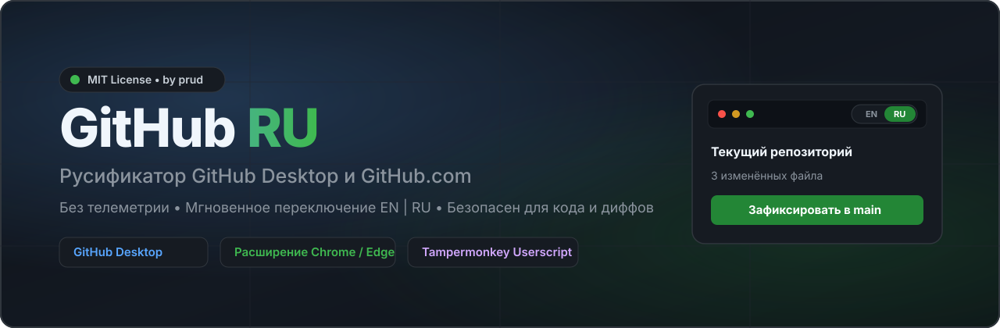

# 🇷🇺 GitHub RU — Русификатор GitHub Desktop и GitHub.com



[](package.json)
[](LICENSE)
[](#installation)
[](https://github.com/PrudnikovMS/github-ru/stargazers)

> **Единая открытая русская локализация для настольного клиента GitHub Desktop и веб-сайта GitHub.com** (браузерное расширение Manifest V3 + скрипт Tampermonkey / Violentmonkey).  
> Работает без телеметрии и внешних зависимостей, бережно сохраняет оригиналы DOM-узлов React/SPA и позволяет переключать язык **`EN | RU`** в один клик.

---

## ✨ Возможности

- **🖥️ Полная локализация GitHub Desktop (Windows)**:
  - Перевод верхнего меню (`Файл`, `Правка`, `Вид`, `Репозиторий`, `Ветка`, `Справка`), панели инструментов, вкладок `Изменения` / `История` / `Отложенные изменения`, всех вкладок настроек (`Аккаунты`, `Интеграции`, `Copilot`, `Git`, `Внешний вид`, `Уведомления` и др.) и диалоговых окон.
  - Перехват **нативных контекстных меню Electron** (`show-contextual-menu`).
  - Корректное русское склонение счётчиков (`1 изменённый файл`, `2 изменённых файла`, `5 изменённых файлов`).
  - Аккуратный переключатель **`EN | RU`** в заголовке окна.
- **🌐 Локализация веб-версии `github.com` и `gist.github.com`**:
  - Перевод навигации репозитория (`Код`, `Задачи (Issues)`, `Pull Request'ы`, `Обсуждения`, `Действия (Actions)`, `Проекты`, `Вики`, `Безопасность`, `Аналитика`, `Настройки`), профилей, фильтров, Pull Request-действий и настроек.
  - Полная поддержка SPA-навигации GitHub (`Turbo` / `PJAX` / динамические подгрузки).
  - Компактная плавающая кнопка **`EN | RU`** в правом нижнем углу + popup-переключатель на иконке расширения.
- **🛡️ Безопасность для кода и пользовательских данных**:
  - Никогда не трогает исходный код и диффы (`#diff`, `.CodeMirror`, `.blob-code`, `.react-code-lines`), файлы README (`.markdown-body`), комментарии (`.comment-body`), имена файлов, названия репозиториев/веток, тексты коммитов и поля ввода.
  - Полная обратимость: при переключении на **`EN`** все оригинальные строки восстанавливаются из памяти без перезагрузки страницы.

---

<a id="installation"></a>
## 🚀 Установка

### 1. GitHub Desktop (Windows)

#### Быстрая установка одной строкой (PowerShell)
Откройте **PowerShell** и выполните:
```powershell
irm https://raw.githubusercontent.com/PrudnikovMS/github-ru/main/install.ps1 | iex
```
После установки перезапустите **GitHub Desktop** (или нажмите `Ctrl+R` / `View → Reload`).

#### Повторное применение после обновления GitHub Desktop
Когда GitHub Desktop обновится и создаст новую папку `app-3.x.x`, выполните:
```powershell
powershell -NoProfile -ExecutionPolicy Bypass -File "$env:USERPROFILE\.github-desktop-ru\apply.ps1"
```

#### Полное удаление (откат к оригиналу)
```powershell
irm https://raw.githubusercontent.com/PrudnikovMS/github-ru/main/uninstall.ps1 | iex
```
Или локально:
```powershell
powershell -NoProfile -ExecutionPolicy Bypass -File "$env:USERPROFILE\.github-desktop-ru\uninstall.ps1"
```

---

### 2. GitHub.com — Браузерное расширение (Chrome, Edge, Яндекс Браузер, Opera, Brave, Firefox)

1. Скачайте репозиторий (**Code → Download ZIP**) или соберите его локально (`npm run build`).
2. Откройте страницу расширений в вашем браузере:
   - Chrome: `chrome://extensions`
   - Edge: `edge://extensions`
   - Яндекс / Opera: `browser://extensions` / `opera://extensions`
3. Включите **Режим разработчика (Developer mode)**.
4. Нажмите **Загрузить распакованное расширение (Load unpacked)** и выберите папку [`dist/extension`](dist/extension).
5. Откройте `https://github.com` — интерфейс сразу станет русским, а в углу и в меню расширения появится переключатель **`EN | RU`**.

---

### 3. GitHub.com — Userscript (Tampermonkey / Violentmonkey)

1. Установите расширение [Tampermonkey](https://www.tampermonkey.net/) или [Violentmonkey](https://violentmonkey.github.io/).
2. Нажмите на прямую ссылку для установки скрипта в один клик:
   👉 **[Установить github-ru.user.js](https://raw.githubusercontent.com/PrudnikovMS/github-ru/main/dist/userscript/github-ru.user.js)**

---

## 🗂️ Архитектура проекта

| Путь | Назначение |
| :--- | :--- |
| [`src/core/translator.js`](src/core/translator.js) | Нормализация ключей, русское склонение, перевод времени, поиск по словарям и regex-правилам. |
| [`src/core/dom-engine.js`](src/core/dom-engine.js) | React/SPA-безопасный движок перевода DOM через `WeakMap` + `MutationObserver` + поддержка `AccessText`. |
| [`src/dictionaries/`](src/dictionaries/) | Модульные словари: `common.js`, `desktop.js` (GitHub Desktop), `web.js` (GitHub.com). |
| [`src/desktop/entry.js`](src/desktop/entry.js) | Точка входа для GitHub Desktop (хук Electron `show-contextual-menu` + переключатель в шапке). |
| [`src/web/entry.js`](src/web/entry.js) | Точка входа для GitHub.com (SPA-навигация, исключения кода/Markdown, плавающий виджет). |
| [`scripts/build.cjs`](scripts/build.cjs) | Zero-dependency сборщик всех 3 поставок в `dist/` с проверкой синтаксиса через `vm.Script`. |
| [`dist/`](dist/) | Готовые к использованию сборки: `desktop/`, `extension/` (MV3) и `userscript/`. |
| [`install.ps1`](install.ps1), [`apply.ps1`](apply.ps1), [`uninstall.ps1`](uninstall.ps1) | Скрипты установки, повторного применения и полного отката для Windows. |

---

## 🛠️ Локальная разработка и тестирование

Требуется только **Node.js** (внешние npm-пакеты не нужны):

```bash
npm run build   # Собрать dist/desktop, dist/extension и dist/userscript
npm test        # Прогнать синтаксические и модульные DOM/IPC-тесты
```

---

## 🇬🇧 English Summary

**GitHub RU** is an open-source, zero-dependency Russian localization suite for **GitHub Desktop** (Windows) and **GitHub.com** (Manifest V3 Browser Extension & Tampermonkey Userscript).  
It preserves code blocks, diffs, Markdown READMEs, repository/branch names, and user inputs untouched, and provides an instant **`EN | RU`** toggle.

---

## 📄 Лицензия и примечание

- Распространяется под открытой лицензией **[MIT License](LICENSE)** — автор **prud ([PrudnikovMS](https://github.com/PrudnikovMS))**.
- Это независимый проект сообщества; не является официальным продуктом GitHub, Inc. и не содержит исходного кода или бинарных файлов GitHub Desktop.

⭐ **Если проект оказался полезен — поставьте звёздочку репозиторию на GitHub и делитесь предложениями перевода в [Issues](https://github.com/PrudnikovMS/github-ru/issues)!**
